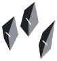

<p align="center">
  <a href="docs/assets/brand/shards-fleet-preview.png">
    <picture>
      <source media="(prefers-color-scheme: dark)" srcset="docs/assets/brand/shards-fleet-dark.svg">
      <source media="(prefers-color-scheme: light)" srcset="docs/assets/brand/shards-fleet-light.svg">
      
    </picture>
  </a>
</p>

<h1 align="center">shards</h1>
<p align="center"><em>MicroVMs for agents, designed for home or at scale.</em></p>

Give an agent a shell and it will install packages, start servers, run builds and, sooner or
later, break something. Shards runs your agents in microVMs: small virtual machines with their
own Linux kernel, behind your processor's virtualization, so what runs inside one sees its
own machine, not yours.

A microVM is made from an image, a Dockerfile or an Agentfile, and it is the OS your agents
run on. Many agents share one microVM, each in a domain of its own: its own processes, files,
networks, devices and permissions, and nothing else unless you grant it. A whole microVM,
agents and all, is saved and restored in microseconds. Your agents can:

- Start in under 200 µs
- Share a microVM's OS, each in its own domain
- Get a microVM to themselves when they shouldn't share one
- Reach only the networks, files and devices you give them
- Use the images, Dockerfiles, Compose files and `docker` command lines you already have
- Use GPUs
- Break anything in their microVM without touching the rest of your computer

Shards never needs root, and it is one file.

```console
$ time shards run vm --kernel vmlinux --init shards-init --cmdline "console=ttyS0 quiet"
shards-init: pid 1 running at uptime 0.012768s
[    0.015804] reboot: Power down

real	0m0.028s
user	0m0.019s
sys	0m0.007s

$ time shards restore vm snap
SHARDS-TEST PASS
[    0.016121] reboot: Power down

real	0m0.007s
user	0m0.002s
sys	0m0.003s
```

Booting Linux, running a program and shutting down took 28 ms. Restoring a saved microVM
took 7 ms, most of it process start and exit. The saved microVM runs the test program from
[Snapshots](#snapshots).

> [!NOTE]
> Output captured on an Apple M5 Max with macOS 26.4.1, from a release build at `e8ec2e6`,
> with Firecracker's CI build of Linux 6.18 as `vmlinux`.

> [!IMPORTANT]
> Shards is young, at 0.x. See [Where things stand](#where-things-stand) for what works on
> which machines.

## Install

Download `shards` for your machine from the
[latest release](https://github.com/hyper-light/shards/releases/latest), and check it
against the release's `SHA256SUMS` (`sha256sum -c` on Linux):

```sh
os=$(uname -s | tr A-Z a-z); arch=$(uname -m | sed 's/x86_64/amd64/; s/aarch64/arm64/')
base=https://github.com/hyper-light/shards/releases/latest/download
curl -fL -O $base/shards-$os-$arch -O $base/SHA256SUMS
grep " shards-$os-$arch\$" SHA256SUMS | shasum -a 256 -c
chmod +x shards-$os-$arch && mv shards-$os-$arch ~/.local/bin/shards
```

On Linux, `shards-linux-amd64-musl` and `shards-linux-arm64-musl` are static, for any
distribution; on Windows, download `shards-windows-amd64.exe`. Or build it from source with
Rust 1.98 (pinned by the toolchain file):

```sh
git clone https://github.com/hyper-light/shards && cd shards
cargo build --release -p shards
cp target/release/shards ~/.local/bin/
```

`shards` is the only file there is. The programs it runs each microVM and its networks with
are inside it; it writes them to your cache directory the first time it needs them.

- **macOS**: 15 or later, on Apple silicon.
- **Linux**: x86_64 or arm64, with access to `/dev/kvm` (usually the `kvm` group). Add
  `--target x86_64-unknown-linux-musl` (or `aarch64-unknown-linux-musl`) for a static binary.
- **Windows**: x86_64, with the Windows Hypervisor Platform, boots microVMs directly
  (`shards run vm --kernel`); images and the daemon are not there yet.

## Quickstart

Run a command in a new microVM made from an image:

```console
$ shards run vm alpine echo hello
hello
```

The first run downloads shards' Linux kernel (19 MB on arm64, 28 MB on x86_64), checks it
against the SHA-256 built into shards, and keeps it. Later runs don't need the network for it.
To download it from somewhere else, such as a mirror, set `SHARDS_KERNEL_URL`; the checksum
still applies. The program each microVM runs first, `shards-init`, is part of shards.

On a terminal, shards draws its own pages. Piped, a `docker` command line prints what
`docker` prints, so scripts written for it keep working.

Images come from any registry, with the logins `docker login` keeps and the certificates
Docker's `certs.d` holds. A registry on another machine that speaks plain HTTP is reached
once Docker's `daemon.json` lists it under `insecure-registries`, as Docker reaches one;
unlike Docker, shards still checks the certificate of one that answers in HTTPS, and never
sends your password in plain HTTP. Its `registry-mirrors` are asked first for what comes
from Docker Hub, each with its own login, never your Docker Hub one.

### Tools that speak the Docker Engine API

The `docker` CLI, `docker compose`, Docker's SDKs, Testcontainers and agent frameworks work
with shards unchanged: what they ask for as a container is a microVM, and each Compose
service is a microVM of its own. `docker buildx build` builds in a microVM, with a builder
of buildx's own on your host's network (`docker buildx create --driver docker-container
--driver-opt network=host`). Point them at shards' Engine API, a file in shards' home that
only your user can reach (no network port):

```console
$ shards run daemon --detached
$ export DOCKER_HOST="unix://$HOME/Library/Application Support/shards/engine.sock"   # macOS
$ export DOCKER_HOST="unix://${XDG_DATA_HOME:-$HOME/.local/share}/shards/engine.sock" # Linux
$ docker run --rm alpine echo hello
hello
```

It is there while shards' daemon runs, which any `shards` command starts. The daemon stays
while a program keeps a connection open or asks something, and stops after
`SHARDS_DAEMON_IDLE` seconds without either (default 900). Served: microVMs (create, start,
attach, wait, logs, exec, copying files in and out, export, changes, processes, stats,
pause, restart, rename, update, stop, kill, remove, prune, list, inspect), events, images
(pull, push, list, inspect, tag, history, remove, prune, save, load, import), an image of
what a microVM changed, builds of a context sent with the call (each `RUN` step in a
microVM), volumes, networks, registry logins, searches (Docker Hub, quay.io and any
registry's catalog), disk use, version and system information. Disk use counts the saved
microVMs that make starts fast, too. Copies are packed and unpacked inside the microVM, and
land where its program will find them: in its volumes, running or stopped, and its tmpfs
mounts while it runs. A network's microVMs reach each other by name and nothing else through
it. A network can let them reach chosen hosts outside, and only those: made with `--opt
shards.egress=api.anthropic.com:443,github.com:443`, its microVMs reach each host on its
port, look up those names and no others, and reach nothing else past themselves; a
network made without it lets nothing out. Stats add what the microVM itself costs your machine (`microvm`: its memory and CPU
time). A setting a microVM can't take is refused with the reason, never dropped. A microVM
refused a process past its `--pids-limit` says so in its events (`pids-limit`, with the
limit and how many it refused), as one that runs out of memory says `oom`.

### A microVM's own engine

`shards run --use-api-socket` gives the program it runs an engine of its own microVM's:
`DOCKER_HOST` points at a socket in its own files (`/run/shards/engine.sock`), so the
`docker` CLI, Testcontainers and CI tools inside it make their containers in that same
microVM. They take nothing of your machine's: not its engine, not its files, not your
other microVMs, and your registry logins stay outside it. Each is on its own, like each
agent in the microVM: the program reaches it on the ports it publishes (`-p 0:5432`, at
`localhost`), and on the default network it reaches no other container or agent. On a
network made in the microVM (`docker network create`, a Compose project's networks),
containers reach one another by name, each on the ports it declares (`EXPOSE`, `expose:`,
`--expose` and the ports it publishes) and on no other. None gets out of the microVM
farther than the program can, and none on an internal network gets out at all. One can
share another's network (`--network container:db`, Compose's `network_mode: service:db`)
as that one has it, and no more. Two microVMs' programs can each make a container called
`db`; on your machine they're listed as `MICROVM.db`. What a microVM's engine made stops
when its program does, and is removed with it. `docker run --use-api-socket` through
shards' Engine API does the same, and the credentials the `docker` CLI would copy in are
refused (it warns). Its program can run containers (`docker run`, attached or not), exec
in them, stop, kill, wait for, read the logs of, list, inspect and remove them, make
networks and volumes for them, connect and disconnect them as they run, and pull images:
shards pulls with the registry logins of whoever ran the microVM, and the image is then
that microVM's own; images of yours it never pulled aren't there for it. A bind (`-v
/work:/src`) is of the microVM's own files, its volumes included, as a bind on any engine
is of that engine's machine's. A volume it makes (`-v data:/var/lib/data`, Compose's
`volumes:`) is the microVM's own: kept on your disk, where your machine lists it as
`MICROVM.data`, reached by no name of yours or of another microVM's, and removed with the
microVM. A call it can't serve yet is refused with what it serves.

### MicroVMs under your own limits

On Linux, `shards run vm --cgroup-parent agents.slice IMAGE` (and Compose's `cgroup_parent:`, through
shards' Engine API file) puts a microVM under a slice of your own systemd manager, so
whatever you give that slice covers every microVM in it: `systemctl --user set-property
agents.slice MemoryMax=16G` caps them together, and `systemctl --user status agents.slice`
shows what they use. Each microVM's memory, its network's process included, is counted
there from its first page, warm starts too, and only the first run under a slice asks
systemd for anything. It works from an ssh login as from a desktop session, with nothing to
set up. A container that shares another's network runs in that one's microVM, so it names
that one's slice or none. A path in place of a slice is refused.

On macOS, which has no such group, `shards run vm --cgroup-parent agents IMAGE` puts a
microVM in a group shards keeps for you, a folder of its home, `groups/agents`, with the
files a Linux cgroup has. Write `4G` to its `memory.high` and its microVMs are held to it
together: past it, each gives back what it holds cold. Past its `memory.max`, with nothing
more to give back, the one that holds the most is stopped, as a cgroup's out-of-memory
killer stops one, and `inspect` says so. `memory.current` shows what they hold.

### Boot a kernel yourself

You need a kernel and a program to run as PID 1. Download shards' kernel, built
reproducibly by CI ([resources/kernel](resources/kernel/README.md)):

```sh
arch=$(uname -m | sed s/arm64/aarch64/)
file=$([ $arch = x86_64 ] && echo vmlinux || echo Image)-6.18.48-$arch
curl -fLo vmlinux https://github.com/hyper-light/shards/releases/download/kernel-6.18.48-64a9427a8997/$file
shasum -a 256 vmlinux
```

| Architecture | SHA-256 |
|---|---|
| aarch64 (arm64) | `87fbe8c0114522cdeb80686050911db0c1b6cf62b5b8544857b373e2f53571a6` |
| x86_64 | `e23c31e89580f2fb8524cb0f560cbd356c22f2de6ae82081352d809151434261` |

Build `shards-init`, a tiny PID 1 that reports Linux's boot time and powers off:

```sh
cargo build -p shards-init --profile guest --target $arch-unknown-linux-musl
cp target/$arch-unknown-linux-musl/guest/shards-init .
```

Boot it:

```console
$ shards run vm --kernel vmlinux --init shards-init --cpus 4 --memory 512 --cmdline "console=ttyS0 quiet"
shards-init: pid 1 running at uptime 0.014162s
[    0.018563] reboot: Power down
```

The console is your terminal, and `Ctrl-A x` stops the microVM. Drop `quiet` to see the
kernel log. `--init` takes any static Linux binary, `--initrd` a whole initramfs, and
`--disk FILE[:ro]` adds `/dev/vda`, `/dev/vdb` and so on. The defaults are 1 CPU and 256 MiB.

## Snapshots

Set a microVM up once, save it, and start copies. A program inside the microVM decides when
to save. The test program does it right away:

```sh
cargo build -p shards-testguest --profile guest --target $arch-unknown-linux-musl
cp target/$arch-unknown-linux-musl/guest/shards-testguest .
```

```console
$ shards run vm --kernel vmlinux --init shards-testguest --snapshot-dir snap \
    --cmdline "console=ttyS0 quiet shards_test=resume"
$ du -h snap/*
 43M	snap/memory
 20K	snap/state
```

Empty memory isn't stored, so 256 MiB of RAM takes 43 MiB on disk. `shards restore vm snap`
starts a copy exactly where the original asked to be saved, as in the example at the top.

- **Copies are cheap.** They share the snapshot's memory until they write to it.
- **Copies don't collide.** Linux reseeds its randomness in each copy as it wakes, so keys
  and IDs differ between copies. Values a program drew before the snapshot don't.
- **Clocks keep running** from the moment of the snapshot. Wall-clock time lags until
  something in the microVM sets it.

`--hold` preloads a copy and waits. A line on stdin starts it in 150 µs:

```console
$ (sleep 1; echo) | shards restore vm snap --hold
shards-ready
SHARDS-TEST PASS
[    0.016274] reboot: Power down
```

A running microVM made from an image is saved whole with `shards save vm NAME`: its memory,
every process, terminal and open file in it, as they are. `shards restore vm NAME` resumes
it where it was, at the same address on its network.

> [!NOTE]
> Snapshots work on macOS and on x86_64 Linux.

## Where things stand

| | Today (2026-10-16) |
|---|---|
| MicroVMs on Apple silicon Macs, and on x86_64 and arm64 Linux | Work: booted directly and made from images; on macOS and x86_64 Linux, repeated runs are served from warm copies |
| MicroVMs on x86_64 Windows | Booted directly (`shards run vm --kernel`); images and the daemon not yet |
| Snapshots, and saving a running microVM whole | macOS and x86_64 Linux |
| Images, Dockerfiles and Agentfiles | Pulled, pushed and built, every `RUN` step in a microVM of the build's own, for other CPUs too under emulation |
| Many agents in one microVM, each in its own domain | Works, from an Agentfile: each agent's own processes, files, networks and devices, and nothing it isn't granted |
| Networks, volumes and devices | Work: a microVM reaches only what you give it, networks deny by default |
| GPUs | macOS and Linux: your machine's GPU, for Vulkan in the microVM (`--gpus all`), tested on Apple's and NVIDIA's. Linux also passes a host's PCI device through to a microVM (VFIO), tested with a test device. Windows not yet |
| `docker` command lines, Compose and the Docker Engine API | Work, through shards' Engine API file |
| Running shards' commands on another machine | Works: `shards create context`, over QUIC |

The target is a usable microVM within 5 ms of the request, using less memory than
Firecracker. The plan and its evidence are in
[docs/design/architecture.md](docs/design/architecture.md).

## Commands

Every command is an action and what it acts on: `shards ACTION THING [ARG...]`.
`shards ACTION` alone lists the ways it is said, and `shards --help` lists every action.

| Command | What it does |
|---|---|
| `shards run vm IMAGE [COMMAND]` | Run a command in a new microVM made from `IMAGE`, pulled first if it isn't here. With `-it`, your terminal is the command's: ctrl-p ctrl-q leaves it running. Repeated runs of an image are served from copies of its booted microVM that the daemon restores ahead of time |
| `shards create vm IMAGE [COMMAND]` | Make a microVM without starting it |
| `shards start vm NAME` · `shards restart vm NAME` | Start a stopped microVM again, its files as it left them; stop one and start it again |
| `shards exec vm NAME COMMAND` | Run a command in a running microVM |
| `shards stop vm NAME` · `shards kill vm NAME` | Stop a microVM: its stop signal, then SIGKILL once its grace is up; or kill it |
| `shards pause vm NAME` · `shards unpause vm NAME` | Freeze a microVM where it is, every vCPU and device, at no CPU; let it run on |
| `shards save vm NAME [SNAPSHOT]` | Save a running microVM whole, its memory, processes and devices as they are, then stop it (or `--leave-running`). Its volumes come with it |
| `shards restore vm NAME [SNAPSHOT]` | Resume a saved microVM exactly where it was, from its newest snapshot unless you name one |
| `shards list vm` · `shards list image` · `shards list volume` | List microVMs, images or volumes |
| `shards list snapshots NAME` · `shards remove snapshot NAME SNAPSHOT...` | List a microVM's snapshots, newest first, with when each was saved and the disk it takes; remove them |
| `shards inspect vm NAME` · `shards inspect image NAME` | What a microVM runs, or an image's documents |
| `shards inspect disk` · `shards inspect system` · `shards inspect guest` | What shards takes on disk; what it is, holds and runs on; the kernel and shards-init runs boot |
| `shards read logs NAME` · `shards watch logs NAME` | What a microVM's command printed; what it prints, as it prints it |
| `shards read processes NAME` · `shards watch processes NAME` | The processes a microVM's agents started and ended, each whole, as the kernel saw them; as they come |
| `shards read ports NAME` | Which of a microVM's agents each published port reaches; for a container its own engine made, who reaches each port it declares or listens on, and what would declare one it listens on that none reaches |
| `shards read changes NAME` | What a microVM changed of its image's files |
| `shards watch vms [NAME...]` · `shards watch system` | What microVMs take of your machine, live; what happens to microVMs and images, as it happens |
| `shards copy vm NAME:PATH PATH` · `shards copy vm PATH NAME:PATH` | Copy files out of a microVM, or into one |
| `shards rename vm NAME NEW_NAME` | Name a microVM again |
| `shards remove vm NAME` · `shards prune vm` | Remove a microVM, and its snapshots with it; remove every stopped one |
| `shards create volume [NAME]` · `shards remove volume NAME` · `shards prune volume` | Make a volume microVMs mount; remove one no microVM mounts; remove those no microVM mounts |
| `shards pull image NAME` · `shards push image NAME` | Download an image and make it a microVM, for this machine's CPU or `--platform`'s; upload one. Every layer is checked against its digests before it is kept |
| `shards build image PATH` | Build an image from the Dockerfile or Agentfile in `PATH`, its `RUN` steps in a microVM of the build's own. `--platform linux/amd64,linux/arm64` builds for both, a step for another CPU under that CPU's emulator inside the build's microVM |
| `shards build agent DIR` · `shards push agent NAME` · `shards sign agent NAME` | Build an agent (or a harness or an MCP server) as an OCI artifact, push it, and sign it with your key or your identity |
| `shards read history IMAGE` · `shards tag image SOURCE TARGET` | How an image's layers were made; name an image again |
| `shards save image NAME` · `shards load image` · `shards export vm NAME` | Images to a tar archive and back; a microVM's files as a tar archive |
| `shards commit vm NAME [IMAGE]` | Make an image of what a microVM changed |
| `shards remove image NAME` · `shards prune image` | Remove an image with its stopped microVMs; remove unused images |
| `shards login registry [SERVER]` · `shards logout registry [SERVER]` | Log in to a registry, or forget a login: kept where `docker login` keeps one, so both find it |
| `shards search image TERM` | Find images on Docker Hub, on quay.io (`quay.io/TERM`), or in any registry's catalog (`HOST/TERM`); on a terminal, whether each runs on this machine, and what its first pull downloads |
| `shards run daemon` · `shards stop daemon` | The daemon that serves runs from warm microVMs, which the first run starts; end it and its runs. It keeps up to `SHARDS_POOL` microVMs ready for each image you run (default 2), and none once the image has gone unused for `SHARDS_POOL_KEEP` seconds (default 600) |
| `shards configure guest --kernel FILE --init FILE` | Choose the kernel and shards-init runs boot, in place of shards' own |
| `shards configure disk [--build-cache-max N%\|SIZE] [--log-history SIZE] ...` | How much of your disk shards keeps: what the build cache always keeps, the most it keeps, and the disk it leaves free (`--build-cache-reserve`, `--build-cache-max`, `--build-cache-free`; 10%, 80% and 20% of the disk by default), and the most a run's log keeps of its newest output (`--log-history`, 1 GiB by default). A change takes at the next build or run. Alone, it shows each setting; `--reset` brings back the defaults |
| `shards run daemon --listen ADDR:PORT` | Let machines you invite run shards on this one, over QUIC on UDP `ADDR:PORT`: run it where the microVMs should run, such as a Linux machine with a GPU. Nothing is reachable until you invite a machine, and it reaches only what you could do here with shards |
| `shards invite client --name NAME --output FILE` | An invitation, a file only you can read, which lets one machine join this one as `NAME`, within an hour. `shards list invitations`, `shards remove invitation NAME`, `shards list clients` and `shards remove client NAME` show and withdraw them |
| `shards create context NAME --invite-file FILE` | Join the machine that invited you. Then `shards --context NAME ACTION THING` runs on that machine, its output and exit status yours, and `shards use context NAME` makes it the one every command runs on; `default` is this one. Its microVMs, images and volumes are that machine's; your logins, environment, terminal and files stay yours: builds send your context and only what changed since the last, your build's secrets cross in memory alone, its outputs come back to your files, `--ssh` reaches your agent here, `copy vm` copies to and from your machine (from Linux and macOS), and `--cidfile` is written here. Tools that speak the Engine API reach it too, through the `Engine` file `shards inspect context NAME` shows |
| `shards run vm --kernel FILE [options]` | Boot a kernel directly in a microVM of its own |
| `shards restore vm DIR [--hold]` | Start a copy of the microVM saved in `DIR`; `--hold` preloads it and waits for a line on stdin |

`docker`'s command lines work too, as `docker` takes them (`shards ps`, `shards logs -f web`,
`shards checkpoint create web first`), for the scripts written for it.

| Option of `run vm --kernel` | What it does |
|---|---|
| `--init FILE` | The static Linux binary to run as PID 1 |
| `--initrd FILE` | An initramfs, instead of `--init` |
| `--cmdline TEXT` | The kernel command line (default: `console=ttyS0 earlycon panic=-1`) |
| `--cpus N` · `--memory MIB` | Size (default: 1 CPU, 256 MiB) |
| `--disk FILE[:ro]` | A disk. Repeat for more |
| `--vsock PATH` | A vsock device. Programs here connect to the Unix socket `PATH` and send `CONNECT <port>`; the guest reaches port P here at `PATH_P`. A restored copy needs its own `PATH` |
| `--rootfs FILE -- COMMAND [ARG...]` | Boot into the EROFS image `FILE` and run `COMMAND` there; its output and exit status are the command's. `--init` must be shards-init |
| `--rootfs FILE --snapshot-dir DIR` | Boot into `FILE` and save a template to `DIR` once the image is mounted, for `restore vm DIR -- COMMAND` |
| `-e` · `-w` · `-u` · `--hostname` · `-i` | With `--rootfs`: the command's environment, directory, user, hostname and stdin |
| `--snapshot-dir DIR` | Save the microVM to `DIR` when it asks, then exit. `--snapshot-then resume` keeps it running. Works with `restore` too |
| `--no-console` | Hide the console |

Exit codes: 0 for shutdown or snapshot, 1 for an error, 2 for bad usage, 3 when the guest
reboots. With `--rootfs`, the command's own, or 125 to 127 when it could not run.
`SHARDS_LOG=debug` shows what shards is doing.

Images, the guest's kernel and shards-init, and saved microVMs are kept in `SHARDS_HOME`, if
you set it; otherwise in `shards` in your data directory (`~/Library/Application Support` on
macOS, `~/.local/share` on Linux, `%LOCALAPPDATA%` on Windows). The programs `shards` writes
out for its microVMs are kept in `SHARDS_CACHE`, if you set it; otherwise in `shards` in your
cache directory (`~/Library/Caches` on macOS, `$XDG_CACHE_HOME` or `~/.cache` on Linux,
`%LOCALAPPDATA%` on Windows).

## Performance

Measured on an Apple M5 Max with macOS 26.4.1 at `e8ec2e6`: 100 runs each, 1 CPU, 256 MiB.
Details are in [docs/benchmarks.md](docs/benchmarks.md).

| Start | p50 | p99 |
|---|---:|---:|
| Restore, preloaded with `--hold` | **149 µs** | 197 µs |
| Restore, in a new process | 794 µs | 1.7 ms |
| Cold boot, to PID 1 | 21.2 ms | 22.2 ms |

Since then every microVM's process confines itself before it starts (on macOS, a sandbox
that takes about 3.7 ms to set up): a restore in a new process and a cold boot take that
much longer. A preloaded restore, and a run served by a microVM made ready ahead, do not.

Running a command in an image you have run before takes **3.0 ms** at p50 and 3.4 ms at
p99, start to exit (`shards run vm IMAGE exit 0`), where a boot takes 34.8 ms. That is 300
runs over 10 saved copies, on a Mac running other VMs. Over a third of it is starting the
`shards` process. The command itself takes 0.4 ms inside the microVM: the microVM
waiting for your run has already touched the memory the first run of the image used.

With `shards run vm -it`, a key you type is echoed in 0.27 ms at p50 and 0.39 ms at p99,
where Docker Desktop on the same Mac takes 0.45 and 1.2 ms.

Linux itself takes 18.6 ms of a cold boot. That is why shards restores snapshots, and why a
leaner kernel is coming.

Peak memory is 12.5 MiB for a restored microVM, 16.4 MiB once it has run a command, and
59.8 MiB for a booted one, guest memory included.

Against Firecracker v1.17.0 on one host (GitHub's x86_64 runner), with the same kernel and
guest, 1 CPU and 128 MiB, 30 interleaved runs each:

| | shards | Firecracker |
|---|---:|---:|
| Boot to ready, p50 | **143 ms** | 147 ms |
| Boot to ready, p99 | **162 ms** | 228 ms |
| VMM memory | **2.4 MiB** | 4.5 MiB |

The guest kernel dominates boot there, under nested virtualization. Snapshot restores are
next.

## How it works

- **Two walls.** The agents in one microVM are kept apart by its kernel: each in namespaces,
  IDs and a view of the files of its own, confined by Landlock and seccomp, reaching only
  what it is granted. The microVM keeps all of them away from your computer and from other
  microVMs: it has its own kernel and runs in its own process.
- **One OS per microVM.** Agents run on their microVM's OS instead of each bringing an image,
  so a snapshot holds one OS however many agents run on it.
- **Speed.** Shards boots once, snapshots, and restores copies. A preloaded copy only has to
  start running.
- **Density.** Copies share snapshot memory until they write to it.
- **No root.** Shards uses `/dev/kvm` on Linux, Hypervisor.framework on macOS and the
  Windows Hypervisor Platform on Windows.
- **No crashes.** Bad input gets an error message. Lints forbid code that can panic, and CI
  enforces them.
- **Portability.** One codebase covers Linux, macOS and Windows on x86_64 and arm64, and CI
  builds all eight targets.

The design and the evidence behind each decision are in
[docs/design/architecture.md](docs/design/architecture.md).

## Documentation

| Doc | What's in it |
|---|---|
| [Architecture](docs/design/architecture.md) | The design, each decision with its evidence, and the plan |
| [Benchmarks](docs/benchmarks.md) | Every measurement, with its command, machine and revision |
| [Research](docs/research/) | The papers, specifications and measurements behind the design |
| [Brand](docs/assets/brand/README.md) | The logo |

## Contributing / development

```sh
cargo build -p shards
cargo test --workspace --release       # boots real machines
cargo clippy --workspace --all-targets --target <triple> -- -D warnings
cargo bench -p shards --bench boot     # and --bench restore
```

The tests need what shards needs (see [Install](#install)). They fetch the kernel and build
the guest programs themselves. Hosts that can't run machines print `SKIP:`. The project rules
are in [CLAUDE.md](CLAUDE.md).

## Acknowledgements

Shards learned a great deal from [Firecracker], and its guest kernel starts from Firecracker's
microVM kernel configuration.

## License

MIT — © 2026 Hyperlight. See [LICENSE](LICENSE).

[Firecracker]: https://github.com/firecracker-microvm/firecracker
