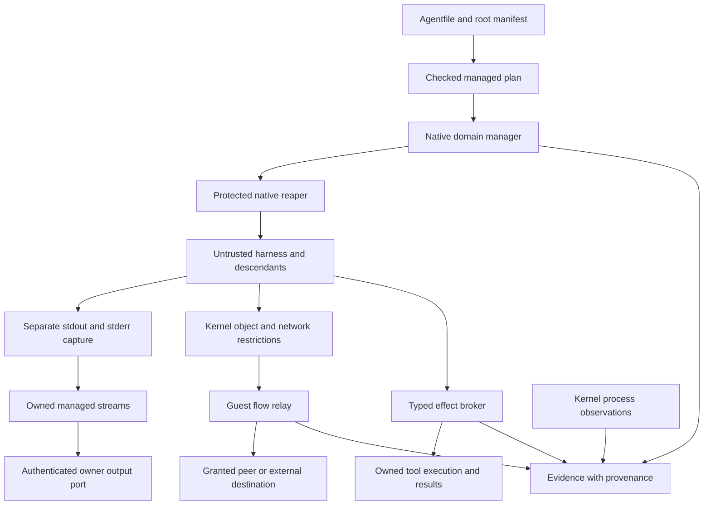

# Managed agents and harnesses: implementation plan and gap register

Status: implementation authorized; phases remain incomplete until their evidence gates pass. Read [the binding development rules](../development-rules.md) before work. Current support excludes Intel Mac; resources/supported-targets.txt defines the seven-target set. Prepared 2026-11-09
Pacific / 2026-11-10 UTC against integration
`9d562993503ab94a699b71e680b690a42436fc71`.

Kiln plan: `01a1c374c2e876e89e12ee45327859d6` (14 dependency-ordered steps;
created for review, not automatically executed).

The user asked for the fixes, integration, modules and **the gaps**. This document
keeps the gaps explicit and maps every one to work and proof. It extends the
[existing control inventory](../research/managed-runtime-design.md), which links
four primary-source reviews and a [checked evidence ledger](../research/managed-runtime-evidence.md).
The proposed tests below are acceptance criteria, not claims that they passed.

## 1. Result to build

An AGENT or HARNESS starts through one native Shards management path. Before its
first untrusted instruction, Shards establishes its identity, object grants,
resource admission, lifetime ownership, private output capture and network policy.
Descendants remain constrained regardless of process names, fork depth, session
changes, executable replacement, hooks or claimed tool IDs.

The owner's simple root `agent.json` / `harness.json` remains required `entrypoint`
plus optional literal `options`. It selects the program, not its own authority.
AGENT/HARNESS supplies the artifact; NETWORK, CONNECT, EXPOSE and volume grants
remain checked declarations. No installation through RUN/VOLUME, implicit shell,
manual piping, or separately installed host sensor is introduced.

The management layer joins three things Shards must keep distinct:

1. **Authority:** kernel restrictions and checked grants decide what may happen.
2. **Owned effects:** a trusted broker owns operations requiring exact tool
   authorization, their resources and their results.
3. **Evidence:** kernel observations, broker facts and harness reports retain their
   different provenance, completeness and uncertainty.

For an arbitrary native binary, Shards can enforce object/flow/resource policy.
It cannot universally identify a function inside that binary as a semantic tool
call. Exact tool authorization therefore requires broker-owned effects and refusal
of alternate effect routes. Merely enabling a harness hook does not close that gap.

### Multi-tenant VM contract

One microVM intentionally hosts multiple AGENTs, HARNESSes or any mixture. The
microVM is a shared boundary; each declared member is a distinct tenant inside it.
Run identity alone is insufficient for capture, control, grants or accounting.
Keep run/generation → stable declared member → execution/channel/flow identity.
An inactive files-only declaration keeps its identity; runnable members are not
renumbered when another declaration has no program. Determine activation from the
verified normalized image with guest-equivalent path resolution, including legal
parent and final symlinks, then check the active mapping before actor release.

Credit, retained offsets, subscriptions, revocation and terminal outcomes belong
to each tenant and channel. A blocked stdout subscriber cannot block its tenant's
stderr, another tenant, the main workload or stop/reap control. Admission charges
the aggregate run as well as the tenant; opening more channels/flows cannot create
more entitlement. Learned throughput changes only already-authorized capacity.

Contain an ordinary tenant failure within that tenant. An observer disconnect
loses observation/credit, not lifecycle ownership. A population observation error
may quarantine its tenant only after held population/leader control succeeds;
unknown population, handles and charges remain represented. Whole-VM escalation
requires a typed failure to maintain the shared containment/control boundary.
Quarantine is neither proven emptiness nor checkpoint readiness. Revalidate save
eligibility and preserve explicit uncertainty; the full freeze/restore cut remains
P11 work. Existing D59 aggregate memory victim selection is a separate unresolved
G12 entitlement question, not a stronger fairness guarantee established here.

Every relevant campaign therefore includes mixed runnable/files-only members,
AGENT/HARNESS mixtures, two tenants emitting concurrently, independent stdout/
stderr stalls, cross-tenant subscriber/control attempts, one tenant exiting or
faulting, and surviving-neighbor progress demonstrated after the failure.

## 2. Complete gap register for this management effort

Labels: **C** = confirmed source behavior; **R** = new requirement not implemented;
**V** = property not yet verified; **P** = policy decision; **I** = inferred risk,
not a demonstrated exploit. This is a management-layer register, not a claim to
enumerate every unrelated Shards defect or certify every existing isolation rule.

| ID | Gap and current evidence | Work that closes it | Completion evidence |
| --- | --- | --- | --- |
| G01 C | Domain fd1/fd2 share one pipe; `prefixed_lines` rewrites bytes onto the main workload's stderr. | P3: separate capture pipes and canonical byte frames; display formatting moves to viewers. | Exact binary/no-newline/invalid-UTF-8 round trips on both channels; main JSON-RPC/stdcopy output is unaffected. |
| G02 R | No dedicated authenticated managed-output port, subscription or resume contract. | P0/P3: private owner endpoint, existing identity/grant integration, generation-scoped cursors. | Unauthorized and cross-domain subscribers receive nothing; observer disconnect does not stop the domain. |
| G03 C/V | An inherited pipe identifies a domain/channel, not its exact descendant writer or logical tool. | P3/P7/P8: dedicated broker-created tool streams; explicit provenance for shared inherited streams. | Concurrent descendants cannot forge another execution's identity; uncertain attribution stays uncertain. |
| G04 C | Internal Switch/Gate routing and peer/engine paths do not all cross the host byte relay. | P4–P6: native guest relay and mandatory interception alongside existing grants. | Remove one route's interception and its mutation test detects actual unmediated bytes. |
| G05 C/V | Same-domain loopback and self-address connections never need the inter-domain switch. | P4: prove namespace-local interception for IPv4/IPv6 and listener return paths. | Tests cover 127.0.0.1, ::1, own addresses, wildcard binds, both directions and all supported socket modes. |
| G06 C/V | Checked-in kernel bases disable NFT_TPROXY/NFT_SOCKET and IPv4/IPv6 TPROXY support. nft_tproxy's hook/transport limits constrain the candidate design. | P4: exact effective-config probes and real-guest mechanism comparison; enable only selected, justified features. | Reproducible configs and runtime probes; missing required features refuse managed launch rather than silently route directly. |
| G07 R/V | IP interception does not settle Unix sockets, abstract sockets, socketpair or SCM_RIGHTS authority transfer. | P6/P7: broker-owned endpoints, transfer policy and denial of uncontrolled cross-domain backend FDs. | Received/passed sockets cannot acquire another principal's grants; no backend-socket handoff bypass. |
| G08 C/R | `domains::Started` retains label/cgroup/output state, not a full owned lifecycle with stable leader handle. | P1/P2: typed identity/generation, pidfd, held cgroup handle, launch-error channel and lifecycle state. | PID reuse, early exit, setup failure, concurrent stop and stale control requests target only their owned scope. |
| G09 C/V | The declared executable becomes namespace PID1; no independent native domain reaper is established by that launch path. | P2: native Shards PID1/reaper role, protected from the actor; measure its actual cost. | Programs that never reap, double-fork, stop or exit early leave no unmanaged population or unbounded zombie accumulation. |
| G10 C/R | Optional domain asks and VM limits are not a complete per-domain CPU/IO/task/FD/storage admission policy. | P0/P1/P2: define entitlements, shared pools and chargeable resources; enforce supported controller/object limits. | Multiplying threads, sockets, files or children cannot multiply admitted entitlement or exhaust protected control capacity. |
| G11 R/V | Child-induced allocations and kernel queues in shared brokers/relays need attribution and aggregate limits. | P1/P4/P5: logical producer charges plus real cgroup/object accounting; measure attribution before fixing process placement. | A child fills broker buffers/queues without exceeding its charged envelope or starving lifecycle control. |
| G12 C/I/P | Current aggregate pressure policy kills the largest populated domain; a smaller actor may provoke pressure against a larger sibling. | P0/P1/P12: preserve explicit owner policy, define protected entitlements, reclaim discretionary borrowing before harming entitled siblings. | Two-domain pressure tests establish victim selection and refusal against actual admitted rights. No claim of stronger sibling guarantees before this policy is settled. |
| G13 R/V | Memory limits alone do not establish disk/inode/growth limits for writable shares, deleted-open files or host-backed storage. | P1/P6/P7: quota/lease handling at the actual storage writer and explicit unsupported-hard-quota outcomes. | Sparse growth, inode floods, hard links and deleted-open data stay within the selected policy; fixtures never touch unrelated user data. |
| G14 C | Kernel process history is asynchronous, can lose information and omits threads; it cannot authorize a tool effect. | P7/P9: effect admission belongs to the broker; process history remains separately labelled evidence. | Forbidden effects never occur with hooks/collector disabled; event loss is explicit and does not grant authority. |
| G15 C/R | External MCP discovery returns endpoints/commands; it is not a proxy/executor for every external tool. | P7: owned local/remote tool registry, checked concrete capabilities, typed requests and rich results. | A tool annotation, URL, request ID or forged result cannot create a grant or select another caller. |
| G16 V/R | Codex/Claude protocol methods, built-ins and local fallbacks have not all been proven compatible with strict effect brokerage. | P8: pinned native adapter inventory; broker executors; direct process/file/network bypass denied where semantic admission is required. | Each supported operation works; disabling hooks or choosing dangerous CLI flags leaves enforcement intact; unsupported paths fail explicitly. |
| G17 R/V | No unified resource-bounded rich-result, artifact and safe-display contract exists for this layer. | P1/P3/P7/P9: versioned frames, leased artifacts, separately authorized raw capture and contextual display encoding. | Malformed/huge/deep content, terminal controls, malicious links and decoder expansion cannot forge control or exhaust parent resources. |
| G18 P/V | Native signed-in CLI compatibility and opaque credentials are different contracts. A readable auth cache delegates its secrets. | P0/P10: explicit credential mode, least scoped grant, refresh/revocation handling; prove any opaque broker's actual provider/client compatibility. | No credentials enter images, ordinary telemetry or unrelated domains; native mode is labelled delegation, not opacity. |
| G19 R/V | Complete durable pre-action audit cannot be inferred from lossy connector/BPF history or a TCP ACK. | P7/P9: reserve required audit before committing broker effects; explicit gap/loss/uncertain states elsewhere. | Full sink/ENOSPC/collector failure cannot silently admit an unaudited mandatory effect; cancellation still progresses. |
| G20 R | New streams, leases, calls and subscriptions lack a defined restore/move/restart generation contract. | P11: quiescence, state ownership, new generation, revalidated grants and explicit uncertain external outcomes. | Stale cursors/tokens/calls fail after restore/move; non-idempotent external requests are never blindly replayed. |
| G21 R/V | Relay/broker death, hook failure and policy replacement need a fail-closed transition contract. | P2/P6/P7/P11: install denial before actor release, linearize admission/revocation and reject stale policy state. | Kill/disable the mechanism mid-flow: no direct-routing fallback, stale authority or uncontrolled worker survives. |
| G22 V | Borrowed connector vendor patch currently maps zero/overflow patience to an unbounded wait; pending upstream correction. | P3/P8/P11 integration dependency where that connector is used; finite typed wait semantics and leak tests. | Zero-withheld and overflow/no-dial tests, dribbled-answer deadline and repeated native Windows handle counts pass. This patch is not adopted as-is. |
| G23 V | Low overhead, fairness, leak freedom and cross-platform behavior of the proposed layer are unmeasured. | P12/P13: adversarial/mutation/fuzz gates and paired measurements on actual supported VM hosts. | Report distributions, resource high-water marks, failures, contention and neighbor impact; pass the supported seven-target and real-VM matrix. |
| G24 R/V | Startup support is not yet a complete real Codex harness demonstration or a typed interactive input/TTY contract. | P3/P8/P10: explicit input ownership, actual supplied Linux artifact, provider grants and sign-in behavior. | A real Codex session works from HARNESS-supplied content without RUN/VOLUME installation; raw protocol output is preserved. |

Existing source evidence is concentrated in `init::{domains,run,procevents,links,
netplan,inroot,frames}`, `server::{server,sandbox}`, `net::{lib,tcp,poll,ring}`,
`shards::{agentfile,setup,grant,confine,volumes}`, and `abi::run`. The supporting
research links the exact inspected revisions. New network prerequisites are cited
in section 6. G22 is a review of the isolated Hex patch, not a defect introduced
into main. G12 is a deliberate existing policy plus an inference to test.

## 3. Modules to build or deepen

Use deep modules with small interfaces. These are proposed names/locations, not
new customer-installed binaries or a promise to introduce every directory listed.
Keep mechanisms private where there is only one implementation; add an adapter
interface only where transports, native harnesses or platforms actually vary.

| Module | Proposed seam | Interface and owned work |
| --- | --- | --- |
| Checked managed plan | `agentfile`, build normalization, `shards::agentfile`, `abi` | Produces immutable `ManagedPlan`: identity, program/argv, object grants, budget authority, required mechanisms and version. Runtime rechecks image/run grants. |
| Identity and resource ledger | shared wire types in `abi::managed`; trusted implementation in guest manager/brokers | `reserve`, `commit`, `release`: non-reusable run/domain/execution generations, policy epoch and hierarchical `BudgetLease`. Resource acquisition is fallible and occurs before effects. |
| Native domain manager | deepen `init::domains`; introduce `init::managed` internals as useful | `prepare`, `start`, `stop`, `wait`: stable handles, native reaper, launch handshake, whole-population cleanup and typed end states. |
| Managed streams | `init::frames`, managed guest relay and host daemon stream handling | `open`, `subscribe`, `consume`, `close`: separate exact-byte channels, leased retained buffers, offsets, EOF/abort/gap, authenticated cursors and fair draining. |
| Flow relay and policy installer | `init::links/netplan` plus a confined native guest relay role; reuse `net` mechanisms | `admit_flow`, `relay`, `revoke`: actual namespace/flow identity, grant check, original tuple, bidirectional queues, UDP outcomes and no backend FD escape. |
| Effect broker | deepen per-domain `server::server` and restricted worker machinery | `submit`, `cancel`, `result`: concrete file/process/network/tool capabilities, checked inputs, owned execution, rich results and explicit terminal outcomes. |
| Native execution and delegation | broker internals plus native domain manager | `launch(CheckedExec)`, `delegate`, `revoke`: executable/workdir objects, literal argv/env, FD allowlist, owned scope and attenuated grants. |
| Harness adapters | native protocol adapters beside the broker | Translate pinned Codex/Claude requests/results and semantic correlations into the same owned operations; never confer authority from harness labels. |
| Evidence and presentation | trusted facts in guest/daemon, safe rendering in CLI/TUI, versioned export | `record`, `observe`, `export`: provenance, operation/outcome, explicit losses, protected raw artifacts, safe views and bounded telemetry. |

The actor gets data endpoints and attenuated capabilities. It gets no manager
control handle, writable policy, ancestor namespace/cgroup handle or supervisor
credential. A tool interface reaching a trusted process does not grant access to
that process's administrative interface or memory.

## 4. Fix merged output and ownership

### Automatic capture and output port

Prepare two private pipes before launching the actor; assign their write ends to
fd1 and fd2, respectively. Close all surplus inherited descriptors. Capture bytes
without UTF-8 assumptions, added newlines, label prefixes or line-size splitting.
The host receives a separate managed-stream envelope; Docker/stdcopy and the main
workload's raw protocol retain their existing representations.

A record carries typed run/domain/execution generation, channel, stream offset,
payload length and source provenance. Supervisor-created end/gap/abort records
cannot be manufactured by child bytes. A shared inherited stream only claims its
domain/channel; dedicated broker-created pipes establish tool/execution ownership.
Writes to granted files or other sockets are handled at their object/flow seams,
not guessed from stdout.

Proposed default: an authenticated, owner-private listening endpoint with an
OS-assigned port, excluding 80/443, reported through the protected control path.
It is distinct from outbound HTTPS destination ports, egress-proxy ports and
internal VSOCK ports. Reuse Shards' identity/cryptographic verification and grant
handling, rather than inventing custom authentication. Endpoint subscription is
a read capability scoped to run/domain/generation and retained range. NETWORK /
EXPOSE is still required to grant additional reachability; capture never creates
implicit public ingress or sibling access.

Use the existing local/remote transport behind this interface. A TCP/TLS bridge
must preserve authentication and credit propagation; no raw backend socket handoff.
Control, input, cancellation, stdout, stderr and bulk artifacts have separate
flow state and progress. The initial input policy is explicitly closed unless a
native adapter or authorized session owns it. Interactive stdin/TTY requires its
own typed protocol, terminal handling and tests; it is not a raw FD shortcut.

### Native lifetime management and reaping

Replace `Started`'s incidental state with an owned domain handle. Capture a pidfd
at birth, hold the cgroup object and retain a launch-status channel that distinguishes
setup/exec failure from an application's exit status. Preserve the existing rule
against allocating or entering ordinary Rust runtime logic unsafely after clone.
The native reaper role starts through a fresh carried Shards executable/helper
mode before executing hostile code; it is not a shell wrapper.

The reaper remains namespace PID1, reaps orphans and manages owned child executions.
Its identity and management FDs are separate from the actor's. Keep only the
syscalls/objects it needs; no network or arbitrary file authority by default.
Outer trusted init can end the entire cgroup even if the reaper fails. Measure the
extra process and resident memory explicitly rather than claim zero overhead.

Domain state is `prepared → starting → running → stopping → draining → ended`.
Stop closes admission first, ends the population, reaps/reconciles it, resolves
drain/abort and releases leases. Leader exit and pipe EOF alone are insufficient.

The lifetime owner is the authoritative Shards run/domain scope. A borrowed
observer or output connection is not that owner; its drop does not stop the actor.
Detached/persistent work needs an explicit retained owner or checked ownership
transfer. Uncontrolled daemonization cannot create persistence. On actual
supervisor loss the domain must remain confined and be terminated by its outer
owner; no fallback to an unowned process tree.

## 5. Resources, delegation and control survival

Admit work using owner → domain → execution → flow/result charges. A lease accounts
for both child use and the work/buffers/handles the parent creates on its behalf.
Reserve capacity for cancellation, refusal, final status and reaping from actual
admitted control-state requirements. Do not keep a global lock across actor I/O,
disk writes, an RPC, a queue drain or a wait.

The ledger covers tasks/threads, memory and retained pages, descriptors, sockets,
pending accepts, queued FD rights, CPU/IO work, disk growth/inodes, artifacts,
decoder expansion, timers, unique telemetry labels and required evidence. Kernel
controllers remain an independent limit; measure actual socket/pipe/shared-memory
attribution. If a shared relay cannot prove hard per-domain kernel accounting,
use isolated relay execution scopes/workers with correctly placed charges and
measure the additional cost. A logical counter alone is not proof of kernel cost.

Security entitlements are owner policy, not learned throughput. Existing explicit
asks and promised primary-workload capacity remain authoritative. Resolve the
current aggregate-victim policy in P0: identify guaranteed allocations, shared
pools and discretionary borrowing. Admit new work only when its guarantee can
be met; refuse excess work and reclaim borrowing before displacing an entitled
sibling. Document any change to D59 explicitly rather than silently imposing an
arbitrary equal split or advertising stronger guarantees over the old policy.

Capacity/chunk/concurrency decisions derive from admitted budgets, OS facts,
protocol bounds and online cost/rate/noise estimates. Learned values operate
inside the authority envelope. Every production literal receives its source or
derivation in the relevant D-entry; benchmark numbers never become constants.

Maintain arbitrary logical delegation depth in an iterative trusted ledger, with
execution scopes at bounded kernel hierarchy depth. Do not create a PID namespace
or cgroup level per reported subagent. Broker-minted grants only narrow authority;
children share ancestor budgets. Reported parent IDs are correlations, not grants.
A cgroup is a resource/lifetime object: stronger per-tool access isolation also
requires a separate kernel principal/view and inaccessible parent/broker objects.
Logical agents sharing one address space cannot be represented as mutually
isolated principals merely by attaching different labels to their messages.

## 6. Fix internal traffic bypass

Retain existing namespace separation, nftables default-deny grants, connection
tracking zones, anti-spoofing, DNS policy and runtime network-update checks. Add a
mandatory path through a Shards-owned **guest** relay for granted internal and
loopback IP traffic. The existing host stack continues to mediate the external
path. Both use the same identity, grant, credit and failure contracts; do not
replace grant enforcement with a permissive proxy.

TPROXY is the preferred IP experiment because it preserves the original destination
without NAT's destination-recovery limitations. It needs transparent sockets and
policy routing. Linux 6.18's nft implementation is limited to PREROUTING and TCP/UDP;
a switch rule therefore does not by itself prove same-domain loopback coverage.
[Kernel TPROXY contract](https://docs.kernel.org/networking/tproxy.html),
[pinned nft implementation](https://raw.githubusercontent.com/torvalds/linux/v6.18/net/netfilter/nft_tproxy.c).

Both checked-in kernel bases already enable nftables/policy routing but disable
NFT_TPROXY/NFT_SOCKET and associated IPv4/IPv6 support. P4 must select minimal
fragments, verify their dependencies and inspect effective built configs/probes.
Do not enable unrelated tracing/LSM stacks or assume BPF JIT establishes them.
[Pinned Netfilter Kconfig](https://raw.githubusercontent.com/torvalds/linux/v6.18/net/netfilter/Kconfig).

The experiment creates trusted interception sockets in the relevant network
namespaces, routes admitted flows into an owned relay, and verifies the return
path for loopback, own-address and wildcard listeners. If it cannot preserve the
required native semantics, compare a minimal cgroup socket-address hook plus
relay lookup. Connect redirection alone is insufficient: cover bind/listen,
connected/unconnected UDP, send/receive metadata and received socket authority.
The mechanism is selected from real compatibility/security/cost evidence in P4,
not declared complete from documentation alone.

Each relay flow binds supervisor-held namespace/link identity, domain generation,
original tuple and policy epoch. Child-supplied IPs, marks and headers do not select
its principal. Exempt only broker-created legs of already admitted flows from
interception; actors cannot set the exemption or receive backend sockets. Install
denial before releasing actors. Missing hooks, relay death or stale generations
leave communication refused, never directly routed.

The route ledger must include internal veth, loopback, own address, peer/engine
forwarding, external ingress/egress, IPv4/IPv6, DNS, UDP/QUIC, Unix pathname/abstract
sockets, socketpair and passed descriptors. VSOCK/management channels remain
inaccessible unless explicitly brokered. Other raw families/protocols remain denied
unless an equally enforced adapter is implemented.

Buffering means mediator-owned, charged bytes/datagrams before release, not an
entire-response delay or redundant copies. Reuse `net`'s readiness, retained-tail
and ring handling. Preserve partial writes, interruption, order, half-close, EOF,
nonblocking calls, datagram boundaries and actual error/drop outcomes. A stalled
consumer receives backpressure or explicit quota failure; optional observers may
receive trusted gaps. A full queue cannot stall lifecycle control or grant a
different flow extra entitlement. TLS/QUIC payloads remain encrypted; semantic
inspection requires an explicitly selected application broker, never hidden TLS
interception or weakened verification.

## 7. Fix tool authorization

Deepen the existing per-domain server and restricted worker machinery into an
effect broker. The trusted side authenticates the principal from its private
endpoint and checked credentials, resolves a concrete capability, validates typed
arguments, reserves resources/evidence and then performs the operation. File
operations use held roots/objects; process launch uses executable/workdir objects,
literal argv/env and an FD allowlist; network operations own their connection.
Do not inspect mutable target pointers and then authorize an untrusted syscall
to continue under a different value.

Tool state is `received → validated → authorized → reserved → executing → terminal`.
Terminal outcomes distinguish success, failure, refusal, cancellation, worker loss
and uncertain external commitment. Completion is accepted at most once; this is
not a claim of exactly-once external effects. Cancellation cannot roll back bytes
or writes already committed. Resource links are new checked accesses, not grants
conferred by tool output. Preserve rich content/error types and lease large
artifacts instead of retaining unlimited responses in the parent.

For strict semantic admission, remove direct bypass rights for the corresponding
effect. A raw writable workspace FD would permit later writes outside per-tool
authorization; an unrestricted local executor would bypass a remote tool broker.
Native harness adapters must therefore inventory all process/file/tool methods
and fallback paths. Where required, constrain native child creation while retaining
allowed threads, and delegate execution to Shards. Mere process naming, approval
notifications, environment IDs and post-action hooks cannot substitute for this.
If a pinned harness cannot operate with those routes closed, strict compatibility
is an explicit unresolved gap to fix, not a silent downgrade to advisory hooks.

Codex's native execution and dynamic-tool protocols and Claude's supported native
tool/MCP interfaces are adapter candidates. Use the pinned schemas/source from the
[tool review](../research/managed-runtime-tool-broker.md), test their real behavior,
and negotiate supported revisions. All share the same broker; they do not introduce
a second process manager or provider-specific privilege path.

Process connector records remain useful history and inventory reconciliation.
They never admit effects, prove exact tool intent, or retroactively repair a lost
short-lived process. Required pre-action durable audit must be an admission
condition at an enforceable seam. If broader attempted-syscall completeness is
required, design and test that kernel mechanism separately; do not claim the
connector or a general asynchronous sensor already supplies it.

## 8. Evidence, credentials and restore/move

Use explicit provenance variants: broker-enforced, kernel-observed,
adapter-reported and unattributed domain data. Trusted envelopes own identity,
sequence, policy/outcome and gap state. Preserve original bytes behind separately
authorized content retention; safe CLI/TUI/HTML/log views escape their own control
syntax, terminal sequences, invalid encodings and misleading labels. Ordinary
telemetry excludes auth material and minimizes content. Bound exporter queues,
attributes and cardinality; an exporter cannot change enforcement policy.

Where durable evidence is mandatory, reserve its capacity before committing an
effect. When finite retention is exhausted, backpressure/refusal is explicit.
Optional observation may disconnect or report a gap. Do not promise unlimited
lossless capture with finite buffers and an indefinitely stopped consumer.

Credential contracts are explicit. Native sign-in compatibility may delegate a
scoped writable private auth/state directory to the selected harness; that actor
then has the credentials it can read. Opaque inference uses a trusted credential
holder and a documented compatible protocol. A helper returning a bearer token
does not make it opaque. No secrets go into the supplied archive/image, and no
provider endpoint, TLS trust root or account scope is silently rewritten.

For restore/move/restart: quiesce admission, classify in-flight effects, checkpoint
only owned state, establish a new management generation, reinstall grants/relay
policy and revalidate subscriptions before resuming actors. Raw external
conversations and non-idempotent requests are never replayed merely because a
transport reconnected. State lost after an external commit is reported uncertain.
Revocation prevents new uncommitted work; already committed/in-progress effects
have an explicit outcome contract rather than a false rollback claim.

## 9. Dependency-ordered implementation slices

Each slice lands as a reviewed, signed piece on integration. Compile/unit checks
belong with its implementation; heavy integration tests and measurements run
centrally on the combined tree. Audits remain with the coordinator. No straggler
branch is merged merely because it exists or carries an old claimed result.

| Phase | Deliverable | Needs | Gaps | Done when |
| --- | --- | --- | --- | --- |
| P0 | Freeze contracts, route/resource coverage, owner/victim policy and interface/state definitions | none | all; especially G02/G10/G12/G18 | Every gap has a source/status, chosen promise, implementation slice and decisive test. Authority, observation and ownership semantics are unambiguous. |
| P1 | Identity/generation, checked frames and budget leases | P0 | G08/G10/G11/G13/G17 | Untrusted lengths/IDs/stale epochs cannot cause uncharged allocation, identity substitution or leaked reservations; limits have sources/derivations. |
| P2 | Native owned domain lifecycle and protected reaper | P1 | G08/G09/G10/G21 | Native harness/descendants start confined, reap correctly and end as a population on stop/owner loss; no management FD leaks. |
| P3 | Exact-byte stdout/stderr and authenticated owner endpoint | P1/P2 | G01/G02/G03/G17/G24 | Separate channels round-trip unchanged; observers are authorized; offsets/resume and EOF/abort work under backpressure; main output stays independent. |
| P4 | Guest interception proof and exact kernel requirements | P0 | G04/G05/G06/G07/G11 | A documented mechanism passes real-guest loopback/internal/native-socket cases and attribution tests, or refuses unsupported routes. Minimal effective configs and costs are recorded. |
| P5 | Owned buffered relay and producer accounting | P1/P2/P4 | G04/G10/G11/G17 | Both directions/datagrams retain semantics and credit bounds; one hostile owner cannot gain by opening more flows or block cancellation. |
| P6 | Enforce the full route ledger and object-transfer policy | P5 | G04/G05/G06/G07/G13/G21 | All supported route classes pass mediation/grant tests; unsupported families/FD transfers refuse; relay/hook failure never restores direct routing. |
| P7 | Typed effect broker, native executions and delegation | P1/P2/P3 | G03/G07/G13/G14/G15/G17/G19 | Authorization/resources precede actual effects; forged/stale calls and cross-principal cancellation fail; owned children/results clean up on every terminal path. |
| P8 | Pinned Codex/Claude adapters and fallback closure | P7; strict closure also P6 | G03/G14/G15/G16/G22/G24 | Every supported built-in/external effect has a tested executor route; disabling hooks/dangerous flags cannot bypass Shards; unknown versions fail explicitly. |
| P9 | Evidence, required retention, safe display and export | P1/P3/P5/P7 | G03/G14/G17/G19/G21 | Provenance stays honest; malicious output cannot forge control; storage/export failure follows its declared policy without secret leakage or control deadlock. |
| P10 | Credential modes and real supplied Codex example | P3/P6/P8/P9 | G18/G24 | An actual Linux Codex artifact starts via HARNESS with NETWORK/EXPOSE, correct sign-in/grants and private managed output; no RUN/VOLUME installation or embedded secrets. |
| P11 | Revocation, owner transfer, restore/move/restart | P2/P3/P6/P7/P9 | G08/G20/G21/G22 | New generations reject old handles/cursors; state resumes only after enforcement is ready; ambiguous committed effects are not replayed or misreported. |
| P12 | Adversarial, fault, mutation and parser/state-machine campaigns | P3/P6/P8/P9/P10/P11 | all | Every promised guard has a real forbidden-effect test and a meaningful mutation check; failures leave bounded resources and continued control progress. |
| P13 | Cost/compatibility matrix, combined gates, migration docs and examples | P10/P11/P12 | G06/G16/G23/G24 | All relevant real-VM suites and supported seven host targets pass; cost/noise and untested hardware combinations are reported honestly; the single-binary deliverable and prior compatibility requirements hold. |

After P0, P4 can run alongside P1/P2. After lifecycle/budgets, streams and relay
implementation can proceed in separate lanes; broker work can proceed beside
network work. Adapters share the completed broker interface. The coordinator
integrates finished pieces and runs the heavy gates once on the combined revision.
An unresolved proof never licenses a direct fallback or a completeness claim.

## 10. Concrete acceptance and measurement matrix

| Campaign | Required cases and pass condition |
| --- | --- |
| Lifetime/parent protection | Fork/clone/vfork/thread storms, exec replacement, setsid/double-fork, uncooperative PID1, zombies, stopped tasks, leader/reaper/broker/owner death. Population ends and is reaped; no actor can signal/ptrace/read/write/steal FDs from management or siblings. |
| Output/protocol | Simultaneous fd1/fd2 writers, byte-at-a-time/no-newline/large binary output, invalid UTF-8, fake JSON-RPC/events, terminal controls, close/dup/replace FDs and slow subscribers. Raw bytes/channel identity are exact; unsupported per-PID attribution is never invented; lifecycle control progresses. |
| Network coverage | Internal/external, loopback/self, peer/engine, ingress/listeners, DNS, IPv4/IPv6, TCP half-close/reset/nonblocking behavior; connected/unconnected/zero-length/multi-destination UDP, sendmsg/recvmsg, QUIC, fragmentation/PMTU and address presentation. Every supported route is mediated and authorized. |
| Bypass and policy | Forged exemptions/addresses, transferred sockets, namespace/rule changes, inherited rings, unsupported raw families, mutable pathname/sockaddr races, policy replacement and revocation. Actual forbidden effects do not occur; failure never opens a direct route. |
| Tool/delegation | Forged principals/IDs/annotations, bypassed hooks, arbitrary native children, deep logical delegation, narrow child grants, malicious resource URLs, rich results, duplicate/stale completion, cancellation before admission and after commit. Rights never widen; terminal state and side effects remain accurate. |
| Exhaustion | ENOMEM/EMFILE/ENOSPC, full pipes/socket queues/evidence store, many tiny objects/inodes/labels/timers, scratch/host-share growth, pending calls/accepts, decompression expansion and stalled receivers. All costs are admitted/accounted and released; unrelated entitled work and stop/reap remain available. |
| Restore/move/crypto | Stale generations/tokens/cursors, reconnect races, mid-call move, old snapshot compatibility, broken trust/identity and lost commit replies. No stale authority, blind replay, weakened TLS or secret in ordinary logs. |
| Mutation | Remove each targeted grant/interception/identity/credit/FD-inheritance/state check independently and observe its corresponding forbidden effect or ownership violation. A test that only loses an alert is insufficient. |
| Cost | Paired/interleaved same-workload comparisons: baseline isolation, lifecycle/capture, relay, broker and adapters. Record n, p50/p90/p99/max, CPU, allocations/copies, RSS/PSS/kernel charge, retained memory/disk, handles, queue residence, cancellation/reaping and neighbor impact with contention/noise. Existing product targets remain requirements; no invented percentage overhead allowance. |
| Matrix | Host macOS on arm64; Windows/Linux gnu/musl on amd64/arm64; real supported KVM/HVF/WHP guest combinations. Unsupported or unavailable hardware remains explicitly unverified, not a passing skip. Do not resume the paused Windows ARM VM without the user's instruction. |

Use a real observer at the forbidden destination/file/process to establish whether
an effect occurred. Count processes/FDs/handles/leases/artifacts after failures,
not just successful output. Fuzz both parsers and state transitions under an
explicit resource envelope. Measurements validate a method; their numbers are
not copied into runtime policy. Every required production literal and every
coverage exception is documented in the corresponding design decision.

## 11. Existing work and completion definition

The minimal local-manifest feature is already on integration: a real directory
agent and tar harness failed to start under the old code and passed after the
fix. That fixture uses testguest, not the real Codex CLI. Integration also has the
verified NR_CPUS kernel pin. Their combined lint/workspace validation is separate
from this plan and proves none of the new management-layer guarantees by itself.

Baseline gate B01 is still open at this revision: all eight lint targets passed;
the Linux workspace reported 2,704 passed, one failed and 85 ignored. The failure
is `boots_the_hosts_maximum_vcpu_count`: the guest reports 255 CPUs, while the
shared test fixture still copies the old `KERNEL_NR_CPUS = 64`. The fixture must
derive the value from the actual architecture-specific kernel config, then rerun
the affected boot and snapshot-storm cases and closing gates. This is an existing
baseline validation gap, separate from G01–G24; it must not be described as a
failed 255-vCPU boot or counted as a test of the proposed layer.

The layer is complete only when every gap above is either closed by the stated
evidence or explicitly retained as a supported-contract limit, with no claim that
an unsupported route is mediated. Required user promises cannot be reclassified
as optional to pass the gate. The guest kernel and trusted Shards mechanisms remain
trusted; this plan does not claim immunity to every kernel vulnerability, hardware
covert channel or abuse of deliberately delegated read/write/credential authority.
